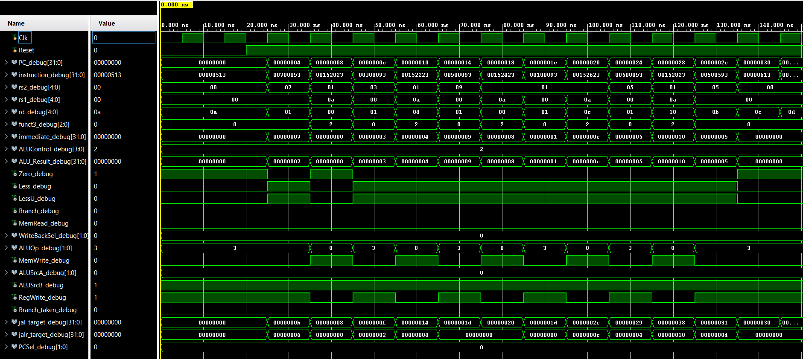

# Single-Cycle RISC-V Processor (RV32I)

A modular **32-bit single-cycle RISC-V processor** implemented in Verilog HDL, supporting the complete **RV32I base integer instruction set**. The processor integrates instruction fetch, decode, execution, memory access, write-back, and control-flow handling within a single clock cycle.


---

## Microarchitecture


---

## Supported Instructions

| Type                | Instructions                                         |
| ------------------- | ---------------------------------------------------- |
| **R-type**          | ADD, SUB, AND, OR, XOR, SLL, SRL, SRA, SLT, SLTU     |
| **I-type (ALU)**    | ADDI, ANDI, ORI, XORI, SLTI, SLTIU, SLLI, SRLI, SRAI |
| **I-type (Load)**   | LB, LH, LW, LBU, LHU                                 |
| **S-type (Store)**  | SB, SH, SW                                           |
| **B-type (Branch)** | BEQ, BNE, BLT, BGE, BLTU, BGEU                       |
| **U-type**          | LUI, AUIPC                                           |
| **J-type**          | JAL, JALR                                            |

---

## Project Structure

```text
RISC_V_Single_Cycle/
│
├── architecture/
│   └── RV32I.png
│
├── rtl/
│   ├── ALU.v
│   ├── ALU_control_unit.v
│   ├── PC.v
│   ├── PC_adder.v
│   ├── adder.v
│   ├── data.mem
│   ├── data_memory.v
│   ├── imm_gen.v
│   ├── instruction_mem.v
│   ├── main_control_unit.v
│   ├── mux.v
│   ├── mux4to1.v
│   ├── processor.v
│   └── register_file.v
│
├── simulation/
│   └── tb_processor.v
│
├── waveform/
│   └── waveform_bubble_sort.png
│
├── LICENSE
└── README.md
```

---

## How It Works

Each instruction is executed completely within a single clock cycle.

1. **Fetch** — The Program Counter addresses instruction memory, while `PC + 4` is computed in parallel.

2. **Decode** — The instruction fields (`opcode`, `rs1`, `rs2`, `rd`, `funct3`) are extracted. The register file reads source operands, the immediate generator reconstructs the instruction immediate, and the main control unit generates datapath control signals.

3. **Execute** — The ALU performs arithmetic, logical, shift, comparison, or address-generation operations. Operand multiplexers select the appropriate ALU inputs depending on the instruction type.

4. **Memory Access** — Load and store instructions access data memory with byte, halfword, or word granularity based on `funct3`.

5. **Write-Back** — The write-back logic selects the appropriate value to be written into the destination register:

   * ALU result
   * Memory read data
   * `PC + 4` for `JAL` and `JALR`

6. **Next PC** — The next-PC multiplexer selects one of four possible addresses:

   * `PC + 4`
   * Branch target
   * JAL target
   * JALR target

---

## Control Path

The processor uses separate **Main Control** and **ALU Control** units.

### Main Control Unit

The main control unit decodes the instruction opcode and generates high-level datapath control signals.

```text
Branch
MemRead
MemWrite
RegWrite
WriteBackSel
ALUSrcA
ALUSrcB
ALUOp
```

### ALU Control Unit

The ALU Control Unit uses `ALUOp`, `funct3`, and `instruction[30]` to select the exact ALU operation.

For example:

```text
funct3 = 000, instruction[30] = 0 → ADD
funct3 = 000, instruction[30] = 1 → SUB

funct3 = 101, instruction[30] = 0 → SRL
funct3 = 101, instruction[30] = 1 → SRA
```

---

## Branch and Jump Logic

### Conditional Branches

The processor supports all RV32I conditional branches:

```text
BEQ   BNE
BLT   BGE
BLTU  BGEU
```

Branch decisions use three comparison outputs from the ALU:

```text
Zero   → Equality comparison
Less   → Signed comparison
LessU  → Unsigned comparison
```

The branch target is calculated as:

```text
Branch Target = PC + Immediate
```

### JAL

For a `JAL` instruction:

```text
Target Address = PC + Immediate
```

The processor writes `PC + 4` into the destination register as the return address.

### JALR

For a `JALR` instruction:

```text
Target Address = (rs1 + Immediate) & ~1
```

The least significant bit is cleared according to the RISC-V ISA specification.

---

## Memory Access

The data memory supports byte-addressable access while internally storing 32-bit words.

```text
address[11:2] → Word Index
address[1:0]  → Byte Offset
```

### Supported Loads

```text
LB    Load Byte (Signed)
LH    Load Halfword (Signed)
LW    Load Word
LBU   Load Byte (Unsigned)
LHU   Load Halfword (Unsigned)
```

### Supported Stores

```text
SB    Store Byte
SH    Store Halfword
SW    Store Word
```

Signed loads perform sign extension, while unsigned loads perform zero extension.

---

## Register File

The processor contains a standard RISC-V integer register file:

```text
32 Registers × 32 bits
```

Register `x0` is hardwired to zero:

```text
x0 = 0
```

Writes to `x0` are ignored, and reads from `x0` always return zero.

---

## Simulation

The processor includes a dedicated testbench:

```text
tb_processor.v
```

Internal debug signals are exposed for waveform inspection, including:

* Program Counter
* Current Instruction
* Opcode and Function Fields
* Register Addresses
* Immediate Value
* ALU Control
* ALU Result
* Memory Read Data
* Branch Decision
* JAL/JALR Targets
* Next-PC Selection
* Register Write Enable

### Simulation Waveform




---

## Single-Cycle Datapath

Unlike a pipelined processor, there are no pipeline registers between execution stages.

Every instruction conceptually passes through:

```text
FETCH
  ↓
DECODE
  ↓
EXECUTE
  ↓
MEMORY ACCESS
  ↓
WRITE-BACK
  ↓
NEXT PC
```

All of these operations are completed within a single clock cycle.

### Advantages

* Simple and modular architecture
* Easy to understand and debug
* Clear separation between datapath and control logic
* Useful for learning processor design
* Good foundation for pipelined processor design

### Limitation

The clock period must be long enough to accommodate the complete critical path of the slowest instruction.

For example:

```text
PC
 ↓
Instruction Memory
 ↓
Register File
 ↓
ALU
 ↓
Data Memory
 ↓
Write-Back
```

This limits the maximum clock frequency compared with pipelined processor architectures.


